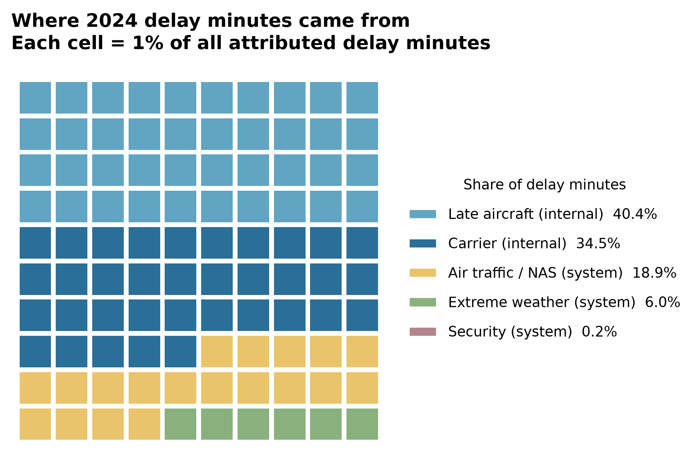
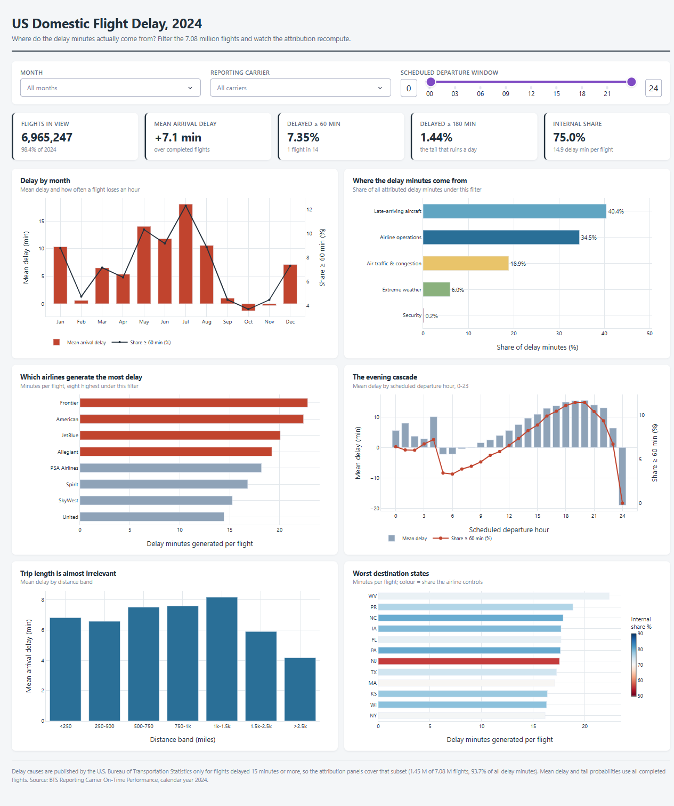

# US Domestic Flight Delay Drivers

**CISC7204 Data Science and Data Visualization | Assignment 02 | Class K, Pair 14**

LI Yingfang (mc661599) | LI Tianhao (mc663312)

An end-to-end analysis of **7,079,061 U.S. domestic flights in 2024**. The project attributes delay minutes to the five causes published by the U.S. Bureau of Transportation Statistics, tests which observable factors matter most for delay length and severe-delay risk, and turns the evidence into static figures and an interactive Dash dashboard.

> **Research question**
>
> Which factors - distance, month, reporting carrier, origin airport and scheduled departure time - most strongly influence the length and frequency of U.S. domestic flight delays, and how can an interactive dashboard communicate these patterns clearly to a non-specialist?

<p align="center">
  
  
</p>

---

## Results at a glance

| Measure | 2024 result |
|---|---:|
| Reported domestic flights | 7,079,061 |
| Completed flights with a known arrival delay | 6,965,247 |
| Mean arrival delay | +7.1 min |
| Median arrival delay | -6.0 min |
| Delayed at least 60 min | 7.35% |
| Delayed at least 180 min | 1.44% |
| Delay minutes attributed to airline-controlled causes | **75.0%** |
| Delay minutes attributed to system causes | **25.0%** |

### Key findings

1. **Most delay minutes are airline-controlled.** Carrier and late-aircraft causes account for 75.0% of attributable minutes. Late-arriving aircraft alone accounts for 40.4%, while air-traffic, weather and security together account for 25.0%.
2. **Timing matters more than the carrier label.** In the five-factor OLS comparison, departure hour contributes 41.1% of explained variance and month contributes 38.6%. Carrier follows at 17.1%, origin airport at 3.0% and distance at 0.3%.
3. **Distance is not the main driver.** Once departure time, month and carrier are controlled, distance has almost no explanatory power. The apparent distance effect in the earlier Module 04 scatter plot was a confounding artefact.
4. **The average is not the passenger experience.** The median flight arrives 6 minutes early, while the mean is 7.1 minutes late and sits at the 73rd percentile. The worst 1% of flights generate 25.1% of all delay minutes.
5. **A proposed mean-versus-tail paradox did not hold.** Across months, mean delay and the share of flights delayed at least 60 minutes move together almost perfectly (r = 0.998). We report this null result and focus instead on the concentration and conditional patterns that remain supported.

The modelling is deliberately presented as **ranking evidence, not a flight-level predictor**. The five-factor OLS model reaches R-squared 0.029, and the 60-minute logistic model reaches AUC 0.679 on held-out flights. Those values are useful for comparing patterns and insufficient for promising a specific arrival time.

---

## Repository map

```text
Analysis/
|- README.md
|- requirements.txt
|- run_all.py
|- src/
|  |- common.py                 shared paths, schema, labels and plot defaults
|  |- 01_ingest.py              download, clean, validate and aggregate BTS files
|  |- 05_proposal_figure.py     print-ready version of the proposal figure
|  `- py2ipynb.py               notebook build and execution helper
|- notebooks/
|  |- 01_Data_Preparation.ipynb
|  |- 02_Delay_Attribution_EDA.ipynb
|  |- 03_Right_Tail_Paradox.ipynb
|  `- 04_Statistical_Modelling.ipynb
|- dashboard/
|  |- data_access.py            filtering and metric recomputation
|  `- app.py                    six-panel Dash application
|- figures/                     16 publication-ready PNG figures
|- outputs/                     CSV and text summaries used in the write-up
`- data/
   |- raw/                       source files, excluded from Git
   `- processed/                 parquet and aggregate cache, excluded from Git
```

Raw and processed data are intentionally excluded from version control because they total hundreds of megabytes and are reproducible from the public sources.

---

## Run the project

Python 3.14 is recommended.

```bash
cd Analysis
pip install -r requirements.txt

# Rebuild the data, execute all four notebooks and regenerate the figures
python run_all.py

# If the processed parquet is already present, run the notebooks only
python run_all.py --skip-ingest

# Launch the dashboard
python dashboard/app.py
# open http://127.0.0.1:8050
```

`run_all.py` rebuilds the notebooks from their `_source/*.py` files and executes them in a fresh kernel. A successful run demonstrates that no result depends on stale notebook state.

### What each notebook answers

| Notebook | Question | Main output |
|---|---|---|
| 01 Data Preparation | Is the data complete and internally consistent? | Typed 7.08M-row parquet, coverage and threshold checks |
| 02 Delay Attribution EDA | Where do delay minutes come from? | Cause waffle, monthly composition, carrier, hour, distance and state views |
| 03 Right Tail Paradox | Does the average describe the risk? | Percentiles, Lorenz curve, mean-versus-tail diagnostics |
| 04 Statistical Modelling | Which factor matters most? | Univariate and incremental R-squared, p90 quantile model, logistic risk model |

Every reported figure is saved in `figures/`; machine-readable result summaries are in `outputs/`.

---

## Data

| Source | Use | Link |
|---|---|---|
| BTS Reporting Carrier On-Time Performance, 2024 | Primary flight-level data, 12 monthly files | [BTS PREZIP](https://transtats.bts.gov/PREZIP/On_Time_Reporting_Carrier_On_Time_Performance_1987_present_2024_1.zip) |
| BTS Airline On-Time Performance: Delay Cause | Cross-check of national cause shares | [BTS delay cause](https://www.transtats.bts.gov/OT_Delay/OT_DelayCause1.asp) |
| OurAirports airports.csv | Coordinates and state reference for maps | [OurAirports data](https://davidmegginson.github.io/ourairports-data/airports.csv) |

The BTS files are U.S. federal government data and are publicly redistributable. The project uses every reported domestic flight in the 2024 files, not a convenience sample.

**Reporting-threshold note:** BTS publishes the five cause-minute fields only for flights delayed by at least 15 minutes. The analysis verifies this rule directly: 1,449,964 of the 1,449,966 flights at or above the threshold have a complete cause breakdown (99.9999%). All cause-share statements are scoped to that attribution universe; counts, means and percentiles use all completed flights.

---

## Method summary

- **Data preparation:** standardise 110 source fields, retain the analysis columns, convert to efficient types and validate counts, duplicates, missingness and the 15-minute threshold.
- **Descriptive attribution:** group reported delay minutes into airline-controlled causes (carrier and late aircraft) and system causes (air traffic, weather and security).
- **Tail analysis:** compare mean, median, percentiles and severe-delay shares; use a Lorenz curve to show how delay minutes concentrate in the worst flights.
- **Factor comparison:** fit OLS on a 600,000-flight sample with HC1 robust errors; compare incremental R-squared contributions for hour, month, carrier, origin airport and distance.
- **Robustness:** fit p90 quantile and 60-minute logistic models on a 250,000-flight subsample with a fixed seed.
- **Interaction:** expose six linked charts and three filters in Dash; recompute metrics after each filter rather than displaying pre-rendered images.

The models are used to compare aggregate patterns. BTS cause minutes are a reported partition, not an independent causal experiment.

---

## Course module coverage

| Module | Technique | Project use |
|---|---|---|
| 01 | Waffle, histogram, box and distribution plots | Cause composition and delay distribution |
| 02 | Bar, scatter, bubble and composition charts | Carrier, distance and airport comparisons |
| 03 | Geographic encoding and choropleth critique | Equal-size state tile grid |
| 04 | Plotly, Dash, callbacks and linked views | Six-panel interactive dashboard |
| 05 | Selection and data storytelling | Proposal, README, final visual and limitations |

---

## Limitations

1. **One year of data.** The 2024 snapshot cannot distinguish a structural pattern from a one-year operational shock.
2. **Cause minutes follow BTS attribution rules.** Overlapping causes are assigned by BTS; the 75/25 split is not an independent causal decomposition.
3. **The models rank, they do not predict.** R-squared 0.029 and AUC 0.679 show that flight-level delay depends on events outside the five available factors.
4. **No independent weather covariates.** "System" means the category BTS reports, not a separately verified storm or air-traffic event.
5. **Heavy models use documented samples.** The OLS and tail models use fixed-seed samples so the workflow remains fast and reproducible; descriptive results use every completed flight.

---

## Team

- **LI Yingfang (mc661599)** - data preparation and quality, exploratory analysis, static figures, success checklist.
- **LI Tianhao (mc663312)** - statistical modelling, Dash dashboard, final visual, meeting notes and submission liaison.

Course: CISC7204 Data Science and Data Visualization  
Coursework: Assignment 02 - Pair Project
