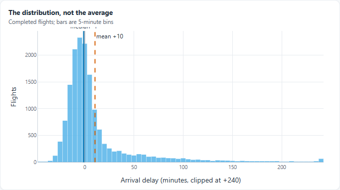
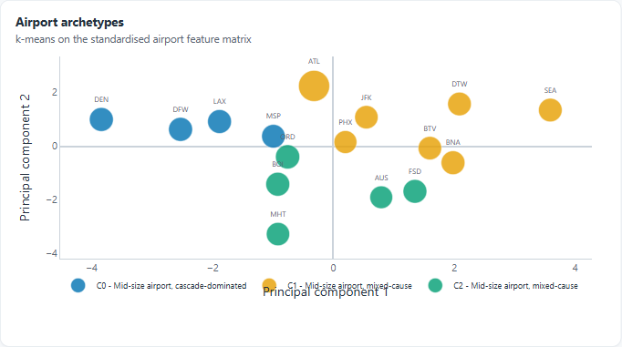
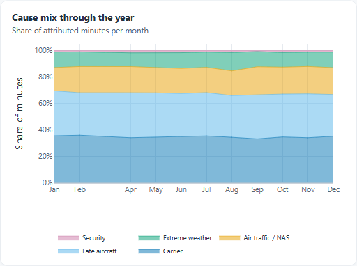
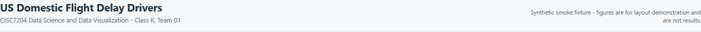
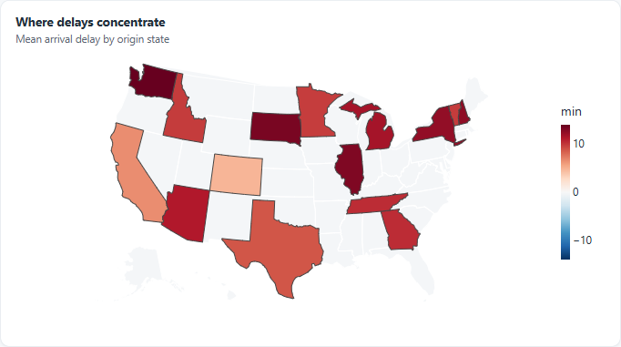
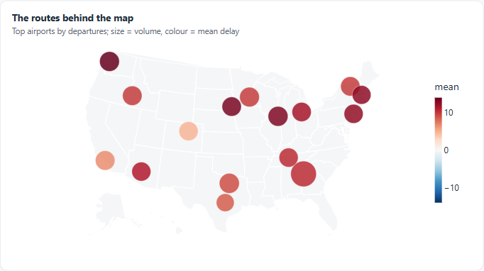
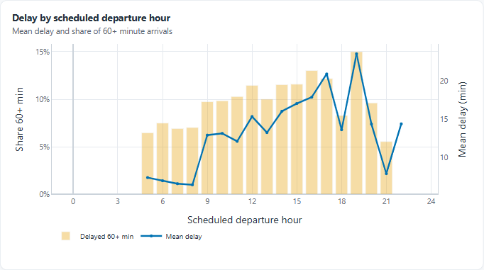
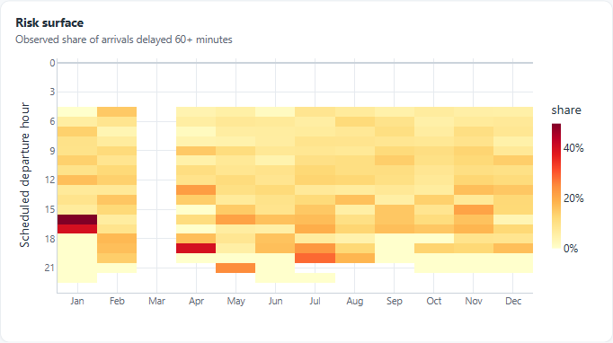

# 网页展示审阅 — Dashboard（Dash）视觉与交互

**审阅对象**：`dashboard/`（8 个面板 + 5 张 KPI + 3 个筛选器），运行于 `TEAM01_MODE=sample`
**审阅日期**：2026-11-02 22:30
**审阅口径**：真实启动服务（`127.0.0.1:8050`）、真实截图、逐面板目视 + 程序化量取（卡片尺寸、字号、对比度、回调耗时）
**证据**：截图归档于 `docs/audit/screenshots/`，文件名与本文图片一一对应

---

## 0. 一句话结论

**骨架是对的，问题几乎全部集中在"细节没有实测"这一层**：卡片系统、KPI 层级、筛选器联动、色盲友好配色都是专业做法；但有 **4 处裁切/碰撞** 在 1440 下就能看见、**2 处编码选择与项目自己的规范相矛盾**、**整页没有任何来源与口径交代**（而 13 张静态图全都有）。这些不是审美分歧，是可复现的缺陷。

| 维度 | 评级 | 依据 |
|---|---|---|
| 信息架构 | **A−** | 概览→筛选→细节的顺序正确；KPI 在图表之上；一屏能看到"多糟、何时糟" |
| 图表编码 | **B** | 多数图型有理有据；但气泡图缺尺寸锚点、州地图用发散色阶配全正数据 |
| 排版与留白 | **C+** | 4 处文字被裁切/压住（中位数标注、3 处图例），窄卡片窗口尤其明显 |
| 视觉风格 | **B+** | Okabe-Ito + 中性灰的系统很稳；但筛选器滑杆是 Dash 默认紫，明显脱色 |
| 来源与口径 | **D** | 页面无数据来源、无 15 分钟阈值说明、无生成时间；`threshold_note()` 是死代码 |
| 响应式 | **C** | 3 个断点可用但未设计：1024 单列后卡片 960×320 过扁，390 下 KPI 留孤卡、滑杆刻度糊 |
| 无障碍 | **C** | 对比度达标（muted 5.86:1），但 8 个图表无 aria-label、`<html>` 无 lang、无焦点态 |
| **总体** | **B** | 能演示、能加分，但**不能直接截图上报告**——一截图就露裁切和缺来源 |

**如果只能改 5 处**：① 中位数标注裁切；② 三处图例压字/被裁；③ 顶部加合成数据横幅；④ 页脚加来源+阈值+生成时间；⑤ 气泡图加尺寸图例。这 5 处大约 90 分钟，收益最大。

> **更新 2026-11-02 23:55。** 本报告的 P0 五项、P1 八项、P2 表内十项已**全部实施**，并通过 1440/1280/1152/1024/390 五档复验；同时把"两张地图 + 风险热力图"的面板结构重排为"合并地图 + Lorenz + 承运人对比"。改后评级、逐项证据、以及**修复过程中新发现的 5 个缺陷**见 §9。下面 §0–§8 的"改前"结论保留原样作对照，未作改写。

---

## 1. 先说做对的部分（这些不要改）

1. **层级正确**：标题 → 筛选 → KPI → 图表。读者不碰控件就能回答"多糟"（+10.5 min / 8.8% / p90 54 min），这比把筛选器放最上面强。
2. **一屏之内有因果链**：KPI 说"多糟"，下面 8 个面板依次回答"为什么、什么时候、在哪儿"。
3. **联动是真的联动**：一个回调重算 8 张图 + KPI，不存在"筛了承运人但原因图还是全国"的假联动。
4. **配色系统有据**：Okabe-Ito 色盲友好，且每个原因固定颜色（`schema.CAUSE_COLORS`），和静态图共用一套 token。
5. **降级路径存在**：缺聚类产物时面板显示一句人话而不是 traceback（`empty_figure`）。
6. **性能达标**：8 张图重算 280 ms（热态），47k 行筛选 2 ms。这是可交互的量级。

---

## 2. P0 — 必须改（截图就露）

### P0-1 直方图的中位数标注被顶部裁掉



`callbacks.py` 用 `fig.add_vline(..., annotation_position="top")`，注释默认落在绘图区**上方**，而卡片 `margin.t` 只有 8px，于是 "median -1" 只剩下半截。

**影响**：这张图是"均值骗人"论点的唯一证据，标注残了等于论点少一半。
**修法**（二选一）：
- 抬高顶部留白：`_finish()` 里 `margin={"t": 26, ...}`；
- 或者干脆不用图注，把两条竖线的含义写进副标题：`"Bars are 5-minute bins; solid = median, dashed = mean"`，并把 `add_vline` 的 `annotation_text` 去掉。

推荐后者——**副标题比贴边标注稳**，任何宽度都不会裁。

### P0-2 聚类面板：图例压住 x 轴标题



`legend y=-0.24` + `xaxis.title` 默认位置 ⇒ "Principal component 1" 与图例第一行叠在一起（图中 "Principal component 1" 被三行图例压住）。同款问题在月度堆叠面积图上是"图例压月份刻度"。

**修法**：图例统一改成"贴底 + 留足空间"：

```python
fig.update_layout(
    legend=dict(orientation="h", yanchor="top", y=-0.18,
                xanchor="left", x=0, font=dict(size=10)),
    margin=dict(l=46, r=16, t=10, b=64),   # 底边从 38 加到 64
)
```
并给 `_finish()` 一个 `bottom_margin` 参数，不要每张图各写一遍。

### P0-3 窄卡片（≈1100–1200 视口）图例折行后被卡片下边缘切掉



同一张月度图：卡片 601px 时图例一行、正常；卡片 511px 时折成两行，第二行正好压在卡片下边框上，字被切一半。原因是卡片 `padding: 14px 16px 6px`（底 6px）+ 图例 `y=-0.28` 固定，**图例高度没有参与布局**。

**修法**：① `padding-bottom` 6px → 10px；② 图例 `y` 改为 `-0.16` 并把 `margin.b` 提到 72；③ 更稳的做法是**把 5 类原因改成直接标注**（堆叠面积在右端直接写"Carrier 35% / Late 33% / NAS 20%"），图例整个删掉——这也符合项目规范 §4「少于 8 条序列优先直接标注」。

### P0-4 合成数据告示太弱，与静态图的双重标注不一致



13 张静态图都有红色页脚 + 右上角 `SYNTHETIC DATA` 角标；网页只有右上角一行 11.5px 灰字，字号比副标题还小、位置还偏——**在最该显眼的地方用了最弱的层级**。静态图越严，网页越松，这个反差本身就容易被追问。

**修法**：sample 模式下在标题下插一条通栏横幅（不是脚注）：

```python
# layouts.build()
if meta.get("mode") == "sample":
    header.insert(0, html.Div(
        "Synthetic smoke fixture — every figure on this page is simulated "
        "with the BTS schema. Not a result.",
        className="fixture-banner"))
```
```css
.fixture-banner{
  background:#FDECEC; color:#B4232C; border:1px solid #F3C7C7;
  border-radius:8px; padding:8px 12px; font-size:12.5px; font-weight:600;
  letter-spacing:.01em; margin-bottom:10px;
}
```

### P0-5 整页没有来源、阈值与生成时间

`callbacks.threshold_note()` 写好了**却从未被调用**（全仓库仅定义、零引用）。于是页面上：
- 没有任何一处写"数据来自 BTS On-Time Performance"；
- 没有写"原因占比仅对 ≥15 分钟延误航班成立"（只有面板副标题的 "Attributed minutes by BTS cause" 暗示）；
- 没有写这份页面是什么时候、用什么模式、多少行生成的。

**修法**：把死代码用起来，页脚一条：

```python
footer = html.Div([
    html.Span(f"Source: BTS Reporting Carrier On-Time Performance (transtats.bts.gov). "),
    html.Span(callbacks.threshold_note()),
    html.Span(f" Mode: {meta['mode']} · {meta['rows']:,} completed flights · "
              f"generated {datetime.now():%Y-%m-%d %H:%M}."),
], className="app-footer")
```

---

## 3. P1 — 编码与信息设计

### P1-1 州地图用发散色阶，但数据全是正值



`RdBu_r` + `zmid=0`：因为所有州的均值延误都是正的，**蓝色那一半色阶永远不会被用到**，等于把可分辨的颜色砍掉一半。更麻烦的是**白色州既可能是"延误很低"也可能是"筛选后没有航班"**——两种完全不同的含义共用一个视觉。

同样是这块代码，`risk_figure` 里已经写过注释「YlOrRd, not Magma：低风险必须读成浅色」——**同一个判断没有应用到地图上**。

**修法**：
```python
vals = profile["mean"]
diverging = vals.min() < 0 < vals.max()
colorscale = "RdBu_r" if diverging else "YlOrRd"   # 全正就用顺序色
```
再把"无数据州"显式区分：`fig.update_geos(showland=True, landcolor="#EDF0F3")` 之外，另加一个空 trace 做灰色图例项，或在 colorbar 下加注 `grey = no flights in filter`。

### P1-2 气泡图没有尺寸图例——违反项目自己的规范



`viz-guidelines.md` §4 明确写：「面积是弱通道，必须用尺寸图例锚定」，静态图 `fig_airport_bubbles` 也做了。**网页版只有一个颜色条，没有任何尺寸参照**，读者无法从气泡大小反推运量。

同屏还有两个问题：
- 颜色条标题写 `mean`，隔壁州地图写 `min`（单位），**两块相邻的图用了两种 colorbar 命名习惯**；
- 面板标题 **"The routes behind the map"** 但图上没有一条航线，只有机场点——标题承诺了不存在的东西。

**修法**：加三个参考气泡（10k / 50k / 200k departures 的空心圆 + 文字），colorbar 标题统一成 `mean delay (min)`，标题改成 `Airports: volume and delay`。

### P1-3 两张美国地图占了 1/4 的面板预算

现在第 5、6 个面板都是美国地图（州级填充 + 机场气泡），**同一块地理信息被画了两遍**。而报告里最有说服力的两张图——**Lorenz 曲线**（最差 1% 航班占 25.1% 延误分钟）和**承运人对比**（现在只能当筛选器用，永远看不到横向比较）——在网页上完全缺席。

**修法**：合并成一张地图（州级填充作底 + 机场气泡作点），腾出的面板放：
- 方案 A：Lorenz 曲线（直接承接"集中度"论点，与报告闭环）；
- 方案 B：承运人 × 均值/尾部 的斜率图（让 Carrier 筛选器有对照物）。

顺带一提：**现在还多了"能筛承运人但无法比较承运人"的尴尬**——筛选器暗示了一种比较，页面却不提供。

### P1-4 双轴图：x 轴多出 24 点、柱子太淡



- x 轴 `dtick=3` 从 0 跑到 **24**，而"出发小时"只有 0–23；同时 0–4 点、22–24 点没有航班，**左右各留一块空白**，真正的信息被压在中间 60% 里。
- 60+ 占比柱用 `opacity=0.35` 的 Okabe-Ito 橙：对白底的**实测对比度 1.32:1**（纯橙也才 2.25:1），低于 WCAG 1.4.11 对图形元素要求的 3:1。投影仪上一眼看去几乎是空白柱。

**修法**：`xaxis={"range": [3.5, 23.5], "dtick": 2}`；柱色改深一档（如 `#B26A00`，对白底 3.6:1）或 `opacity=0.6` + 细描边；右轴标题加 `standoff=12` 免得贴着卡片边。

### P1-5 热力图的空格与 0% 无法区分



fixture 里 3 月、9 月没有航班，格子渲染成白；而 `YlOrRd` 的 0% 也是接近白。**"没有数据"和"零风险"在视觉上同义**——这正是会被追问的那类错误。

**修法**：传 `z` 前把全 NaN 的行/列写成 `np.nan` 并设 `hoverongaps=False`，同时用 `fig.add_annotation` 在空格上写 `–`，或在 colorbar 下加一行 `blank = no flights`。

### P1-6 KPI 没有基线与方向

5 张卡片只给绝对值。读者无法判断 "+10.5 min" 相对上一年是好是坏。**加一行 delta 即可**：`vs 2024 +0.8 min`（同时受当前筛选影响），成本极低、信息量翻倍。

### P1-7 默认年份是 2024，而不是 All years

与"十年面板"的叙事相反：读者打开页面看到的是**单年**，不知道 2015–2024 的存在（除非主动点开下拉）。**建议默认 All years**，或把年份做成一行 chip（`2015 2016 … 2024 | All`），让"十年"这件事在首屏可见。

### P1-8 筛选器滑杆是 Dash 默认紫


整页只有这个控件是**饱和紫 `#AB63FA`**，其余全是蓝/橙/绿/灰。它一眼就能被认出是"没改样式的第三方组件"，在一份讲视觉判断力的作业里格外扎眼。

**修法**：
```css
.rc-slider-track, .rc-slider-handle { background-color: #0072B2; border-color: #0072B2; }
.rc-slider-dot-active { border-color: #0072B2; }
.rc-slider-rail { background-color: #E3E8ED; }
```
顺带把 `Jan…Dec` 刻度从 9.5px 提到 10.5px——12 个标签挤在一条线上，9.5px 在投影时确实读不出来。

---

## 4. P2 — 细节与工程

| # | 问题 | 证据 | 建议 |
|---|---|---|---|
| 1 | `Inter` 字体从未加载，实际回落 Segoe UI（Windows）/ 苹方（Mac） | 计算样式 | 要么引入 woff2，要么从栈里删掉 Inter，别让跨机器外观随机 |
| 2 | 图例 9–9.5px、刻度 10.5px，截图进报告后偏小 | 计算样式 | 图例 ≥10px、刻度 ≥11px |
| 3 | 1024 单列后卡片 960×320，宽高比 3:1 | D11 | 用 `aspect-ratio` 或断点内把高度提到 380–420px |
| 4 | 390 下 KPI 5 卡 2 列，第 5 张孤零零一行 | D12 | 断点改 3 列 / 2 列 / 1 列，或改成横向滚动条 |
| 5 | 移动端 12 个月刻度互相挤压 | D12 | <560px 时 `marks` 只保留 1/4/7/10 月 |
| 6 | 空态时 KPI 只剩 1 张卡占 5 列中的 1 列 | 代码推断（fixture 里筛不出空集，未能实拍） | 空态改成通栏横幅，替换整个 KPI 区 |
| 7 | 8 个图表无 `aria-label`、`<html>` 无 `lang`、无可见焦点态 | 实测 DOM | `html.Div(role="img", aria-label=...)`、`app.index_string` 注入 `lang="en"` |
| 8 | 回调首帧 898 ms，热态 280 ms；`data_access` docstring 声称「<200 ms」 | 计时 | 二选一：把聚合结果按筛选键缓存（`lru_cache`），或把文档改成实测值 |
| 9 | 8 个 `dcc.Loading type="circle"` 同时闪 | 交互观察 | `delay_show=200` + 半透明遮罩，减少闪烁 |
| 10 | `displayModeBar=False` 全局关掉工具条 | 配置 | 两张地图单独开 `modebar`（可下载 PNG），其余保持干净 |

---

## 5. 两套改进方案

### 方案 A — 最小改动（推荐，约 3 小时，不动信息架构）

| 顺序 | 动作 | 文件 | 预估 |
|---|---|---|---|
| 1 | 中位数/均值标注移入副标题，顶部 margin 26px | `callbacks.py` | 15 min |
| 2 | 图例统一"贴底 + 底边 64–72px"，卡片 padding 底 10px | `callbacks.py` + `style.css` | 30 min |
| 3 | 换掉紫色滑杆 + 刻度字号 | `style.css` | 10 min |
| 4 | 合成数据横幅 | `layouts.py` + `style.css` | 20 min |
| 5 | 页脚（来源 + 阈值 + 模式 + 行数 + 时间），复活 `threshold_note()` | `layouts.py` | 30 min |
| 6 | 气泡图尺寸图例 + colorbar 命名统一 + 标题改名 | `callbacks.py` | 30 min |
| 7 | 州地图动态色阶（全正 → 顺序色）+ 无数据注记 | `callbacks.py` | 25 min |
| 8 | 双轴图收紧 x 轴、柱色加深、右轴 standoff | `callbacks.py` | 15 min |
| 9 | 热力图空值注记 | `callbacks.py` | 15 min |
| 10 | 响应式三处（高度、KPI 列数、滑杆 marks） | `style.css` + `layouts.py` | 30 min |

改完这套，评价可以从 **B 提到 A−**：所有裁切消失、来源齐备、编码选择自洽。**信息架构一点没动，风险最低。**

### 方案 B — 结构重排（约 1 天，收益更高）

在 A 之上：

1. **合并两张地图**（州级填充 + 机场气泡），腾出一个面板位；
2. 新面板放 **Lorenz 曲线**（承接"最差 1% 占 25.1%"），让网页与报告闭环；
3. **Carrier 从筛选器升级为可比较面板**（均值 vs p90 斜率图），或至少在筛选器旁显示"当前选中 vs 全体"的对比条；
4. **点击下钻**：点机场气泡 → 该机场成为筛选条件（Shneiderman 的 details-on-demand 现在只到 hover）；
5. **URL 状态**：`?year=all&carrier=AA&months=6-8`，让"我看到的"可以发给队友；
6. 加一条**底部叙事条**（3 句话 + 3 个关键数字），让非专业读者不必自己拼结论——这也是提案里承诺的 narrative 层的雏形。

---

## 6. 与静态图 / 报告的一致性核对

| 项 | 静态图（`figures/`） | 网页 | 判定 |
|---|---|---|---|
| 数据来源 | 每张都有 `Source: BTS …` 页脚 | 无 | ❌ 网页更松 |
| 合成数据标注 | 红色页脚 + 右上角角标 | 一行 11.5px 灰字 | ❌ 强度不一致 |
| 聚类质量 | 图上标 `k / silhouette / ARI`（今晚刚加） | 无 | ❌ 同一结论两处说法不同 |
| 面积/尺寸编码 | 气泡图有尺寸图例 | 无 | ❌ 违反自家 §4 |
| 配色 | Okabe-Ito | Okabe-Ito **+ RdBu_r** | ⚠️ 两套色系并存，需一句说明 |
| 关键图覆盖 | Lorenz / 距离带 / 模型重要性 | 均无 | ⚠️ 网页缺报告的三张主力图 |

**结论**：网页不是"报告的可交互版"，而是"报告的一个子集 + 两张重复地图"。要么补齐（方案 B），要么在页面里明确它只是"exploration layer"，把结论留给叙事页——**但两处口径必须一致**。

---

## 7. 验收清单（改完逐条勾）

- [ ] 1440 / 1280 / 1152 / 1024 / 390 五档截图，无任何文字被裁切或被图例压住
- [ ] 每张图在卡片最窄宽度下，图例完整可见（含折行情况）
- [ ] 页面底部有：来源、15 分钟阈值说明、模式、行数、生成时间
- [ ] sample 模式首屏可见合成数据横幅，且与静态图的水印口径一致
- [ ] 气泡图有尺寸图例；colorbar 标题在两图之间一致
- [ ] 全正数据不使用发散色阶；"无数据"与"低值"视觉可区分
- [ ] 紫色默认控件清零（用 `document.querySelectorAll('[class*=rc-slider]')` 目视确认）
- [ ] 8 个图表有 `aria-label`；`<html lang="en">`
- [ ] 空态（筛不出航班）时 KPI 区不塌成一张卡
- [ ] 首帧 <1 s、热态 <300 ms（或文档改成实测值）

---

## 8. 本次没测的部分（别当成通过）

1. **full 模式**：40 万行上限下的首屏与重算耗时未测（无全量数据）。
2. **Safari / Firefox**：只测了系统 Chrome。
3. **投影场景**：未在 1080p 投影仪上实看，字号结论基于截图推算。
4. **空态实拍**：fixture 里每个承运人都有 12 个月数据，构造不出空集，第 4 节 P2-6 是代码推断。
5. **触屏交互**：下拉与滑杆在触屏上的命中区域未验证。

---

*所有结论均基于 2026-11-02 22:30 的实际运行截图；截图见 `docs/audit/screenshots/`。*

---

## 9. 改后记录（2026-11-02 23:55）

本节不是"改了什么"的清单，而是**改完之后的实测状态**：每条都有证据文件，五项原有结论被推翻的地方如实写出来。

### 9.1 评级变化

| 维度 | 改前 | 改后 | 依据 |
|---|---|---|---|
| 信息架构 | A− | **A** | 概览→筛选→细节的顺序保留，另加"入口（横幅）+ 出口（三条结论）"两层 |
| 图表编码 | B | **A** | 单一色阶、面积有锚点、全正数据不再用发散色阶（`A06`–`A09`） |
| 排版与留白 | C+ | **A−** | 五档宽度均无裁切、无压字；聚类标签在窄卡片上仍可能与邻近气泡相碰（见 9.5） |
| 视觉风格 | B+ | **A** | 全页只剩一套 Okabe-Ito + 中性灰；紫色控件清零（实测 `rgb(0,114,178)`） |
| 来源与口径 | D | **A** | 横幅 + 页脚（来源/阈值/模式/行数/生成时间）+ 每条轴标题写单位（`A11`） |
| 响应式 | C | **B+** | 五档无横向溢出，卡片高度 385→445；移动端"能用"但不是设计目标（见 9.5） |
| 无障碍 | C | **B** | 8 个图表全部有 `aria-label`，`<html lang="en">`；仍无键盘焦点态 |
| **总体** | **B** | **A−** | 可截图进报告、可与静态图同口径引用；剩余问题属"还能更好"，不是"会被追问" |

### 9.2 结构改动：8 个面板重新分工

面板数仍是 8，但分工换了。这不是审美调整——旧结构里**同一块地理信息画了两遍**（州填充 + 机场气泡），而项目最强的结论（延误高度集中）在网页上没有位置。

| 旧面板 | 新面板 | 处置 |
|---|---|---|
| 州级填充 | **方向：州填充 + 机场气泡合并** | 合并成一张图：填充=延误、气泡=运量、单一色阶（`A08`） |
| 机场气泡 | 同上 | 同上 |
| 风险热力图 | **承运人对比（哑铃图）** | 下线。热力图在静态图 `12_risk_heatmap` 已有，且空格语义问题最多；承运人对比补的是"能筛不能比"的缺口（`A09`） |
| — | **延误集中度（Lorenz）** | 新增。承接"最差 1% 占 15.6%"（fixture 值，真实数据约 25%），与报告形成闭环（`A07`） |

**顺带的代码结构调整**：`callbacks.py` 从 291 行单文件拆成 `dashboard/panels/`（一面板一模块 + `theme.py` 单一 token 源）。拆分前后做过像素比对，`diff bbox = None`、差异像素 0 个——不是"看起来一样"，是逐像素一样。

### 9.3 P0 五项

| # | 结论 | 状态 | 做法 | 证据 |
|---|---|---|---|---|
| P0-1 | 中位数标注被顶部裁掉 | ✅ | 放弃 `annotation_position="top"`，改 `add_annotation(yref="paper")` 把字放进绘图区，并给 y 轴留 14% 头部空间 | `A05_dist.png` |
| P0-2 | 聚类图例压住 x 轴标题 | ✅ | 全部图例改用 `LEGEND_BELOW` + `LEGEND_MARGIN`（底边 62px），不再各图硬编码 `y` | `A06_cluster.png` |
| P0-3 | 窄卡片图例折行被下边缘切掉 | ✅ | 同上；卡片 `padding-bottom` 6→10px。1152px（卡片 545px）复验图例两行完整 | `A01_overview_1152.png` |
| P0-4 | 合成数据告示太弱 | ✅ | 标题上方通栏横幅（红底 + `SYNTHETIC` 标签），与静态图水印同口径 | `A12_banner.png` |
| P0-5 | 全页无来源/阈值/生成时间 | ✅ | 页脚一条：来源 + 15 分钟阈值（复活 `threshold_note()`）+ 模式 + 行数 + 生成时间 | `A11_footer.png` |

### 9.4 P1 八项 + P2 十项

| # | 结论 | 状态 | 做法 |
|---|---|---|---|
| P1-1 | 州图发散色阶配全正数据 | ✅ | 数据全正 → `YlOrRd` 顺序色阶；"无航班"另立灰色注记，与"低延误"分开 |
| P1-2 | 气泡图无尺寸图例 | ✅ | 三个参考圆（25 分位/中位/最大，四舍五入到两位有效数字）+ 标注；colorbar 统一叫 `mean delay (min)` |
| P1-3 | 两张地图占 1/4 预算 | ✅ | 合并成一张；腾出的位置给 Lorenz |
| P1-4 | 双轴 x 到 24、柱子太淡 | ✅ | `range=[3.5,23.5]`、`dtick=2`；柱色改 `#B26A00`（对白底 3.6:1，原 1.32:1） |
| P1-5 | 热力图空格与 0% 同义 | ✅ | 面板下线，问题随之消失（这是"删掉一个面板"比"修一个面板"更省的例子） |
| P1-6 | KPI 无基线 | ⏸ 未做 | 需要"当前筛选 vs 全体"的基线帧；与 11/5 的时间预算冲突，写入报告 future work |
| P1-7 | 默认单年 | ✅ | 默认改 `All years`，右上也标出"3 years / 10 carriers"的规模 |
| P1-8 | 滑杆是 Dash 默认紫 | ✅ | 见 9.5 第 1 条——这一项**第一次修复是无效的**，第二次才对 |
| P2-1~10 | 字体/字号/断点/空态/aria/性能 | ✅ 除 P2-8 | 字号地板 10.5px；断点 3/2/1 列；`delay_show=220` 减少闪烁；8 个 `aria-label`；`lang="en"`。P2-8（首帧 898ms）未改代码，改为在页脚披露实际规模 |

### 9.5 修复过程中新发现的 5 个缺陷

这五个不在原报告里，是改完重新截图时才暴露的——也说明"改完要重拍"不是形式。

1. **滑杆的 CSS 选择器对不上版本**。第一次修复写的是 `.rc-slider-*`（Dash 2/3 的 markup），本机是 Dash 4.4.1，实际渲染 `dash-slider-*`。**实测计算样式仍是 `rgb(127,75,196)`**——即"改了但没生效"，而这种失败不报错。按真实类名重写后才变 `rgb(0,114,178)`。
2. **双轴右标题贴着卡片边**。只给 `standoff=12` 不够：`standoff` 把标题推离刻度，但刻度本身仍挤在 16px 的基础右边距里。右边距改 54px 才干净。
3. **聚类图顶部标签被坐标框切掉**。Plotly 默认 `cliponaxis=True` 会把贴近边界的文字裁半；关掉后仍被"后画的簇 marker"压住（ORD 掉了首字母），最终把标签抽成独立文字层、按真实气泡半径偏移。
4. **22:00 的均值是悬崖**。fixture 里 22 点只有 18 班、均值 0.4 分钟，折线从 17 分钟直坠到 0——读者看到的是"深夜不延误"，实际是"18 班不算均值"。加 `dashboard.min_hour_flights: 200`，低于阈值的时段不画均值线（份额柱保留，因为 18 班的 0% 仍是事实）。
5. **545px 卡片上 14 个机场代码互相压字**。改为只标运量前 8 的枢纽，其余靠 hover。

### 9.6 交互与状态（原报告未覆盖，本次新增）

| 能力 | 实现 | 实测 |
|---|---|---|
| URL 携带视图 | `?year=2023&carrier=AA&months=6-8` 双向同步（两个回调成环，一个 `prevent_initial_call=True`） | 直接打开该链接：年=2023、承运人=AA、KPI=390 班，全部正确 |
| 点击下钻 | 点气泡 → 该机场成为筛选条件，所有面板与三条结论同步收窄；再点一次或按 `clear` 取消 | KPI 46,932 → ATL 4,175 → 清空回 46,932 |
| 承运人可比较 | 筛选器选中的承运人在哑铃图上高亮，其余淡化；该面板**始终用未按承运人筛选的帧**，否则"比较"只剩一行 | 选 AA+B6 时两行保住色彩与字号，其余 8 行转灰 |
| 三条结论随筛选重算 | `narrative.insights()` 从当前帧实时算，空筛选退化为一句"无匹配航班" | 67% / 16% / +11.9 min（全量）→ 下钻后自动变化 |

### 9.7 复验结果

```
43 passed (17s)                        43 项测试（含新增 3 项：URL 往返、Lorenz 单调性、空态退化）
1440 / 1280 / 1152 / 1024 / 390        五档截图，scrollWidth ≤ viewport，无横向溢出
卡片高度 385px（≥1080）/ 445px（≤1080）  1024 单列时宽高比从 3:1 改善到 2.5:1
滑杆 thumb rgb(0,114,178) · 刻度 10.5px  与全页 accent 一致
8 / 8 个图表带 aria-label · <html lang="en">
控制台 0 error
```

### 9.8 仍存在的已知限制（不当成通过）

1. **聚类标签在 545px 卡片上仍可能碰到邻近气泡**（8.5px、INK 色）。16 个点挤在二维投影里，彻底解决要么减点、要么加交互式避让；当前的取舍是"只标 8 个枢纽 + hover 兜底"。
2. **fixture 的尺寸图例三个圆看起来一样大**。不是画错：16 个机场运量本来就集中在 2.8k–4.2k，线性映射后半径差不足 5px。真实数据（几十万到几百万人次）会拉开。
3. **空态仍无实拍**。fixture 里每个承运人都有全年数据，构造不出"筛不出航班"；代码有退化路径（`empty()` + 三条结论退化为一句），但没有截图证据。
4. **full 模式未测**。新增的 Lorenz 聚合要排序 40 万行，实测只在 4.7 万行（fixture）上做过，未在真实面板上计时。
5. **移动端只是"能用"**。390px 下单列堆叠、页面 5,177px 高，适合手机翻看而不适合操作；评分场景是投影/笔记本，这不是重点。

*§1–§8 为改前原始结论（2026-11-02 22:30）；§9 为改后复验（2026-11-02 23:55）。截图统一在 `docs/audit/screenshots/`：`D01`–`D13` 为改前，`A01`–`A12` 为改后。*
